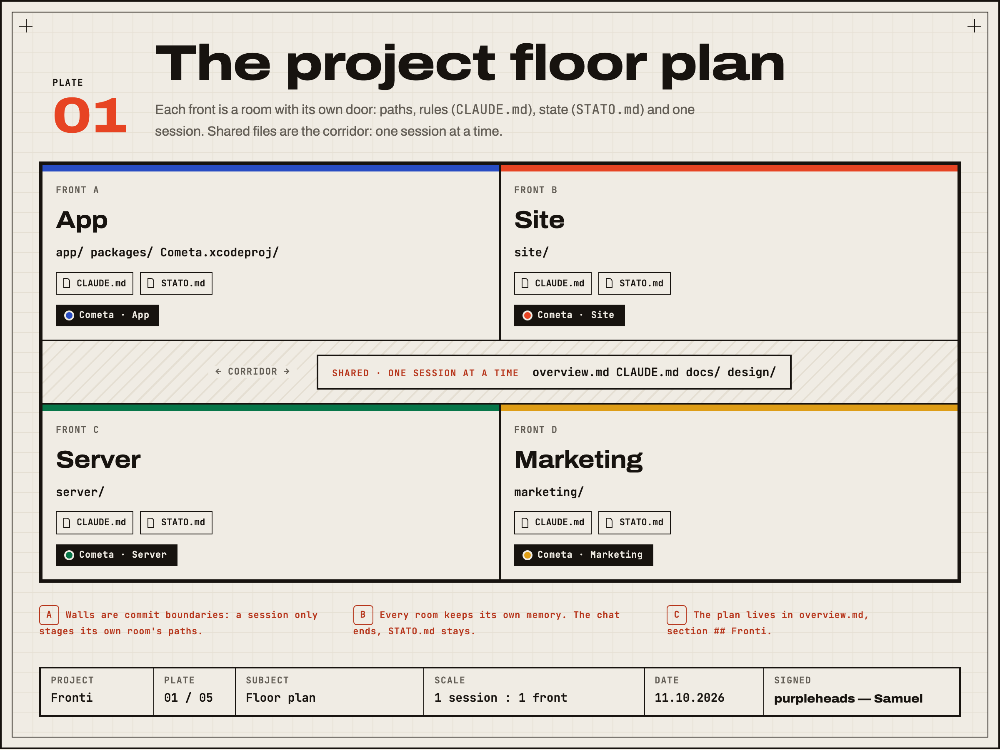
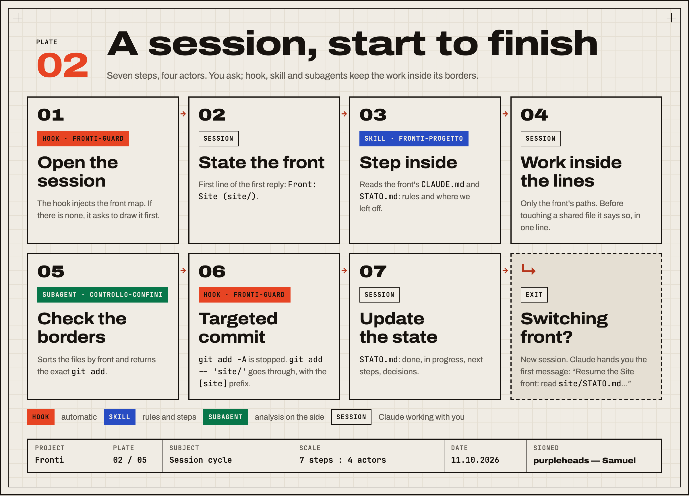
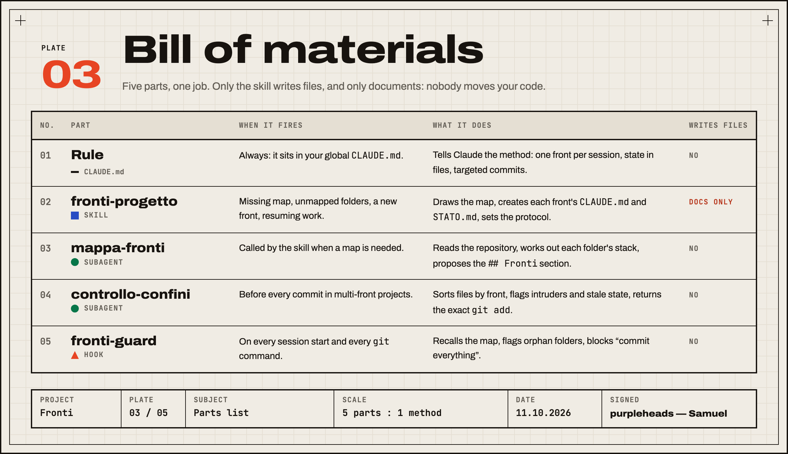
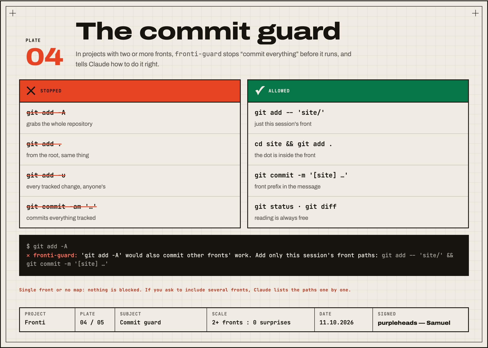
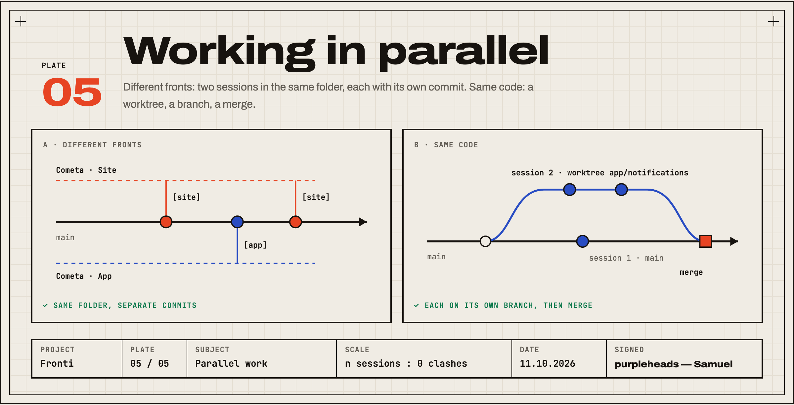

<p align="right"><a href="README.md">Italiano</a> · <b>English</b></p>

# Fronti

**One project, many fronts, one session per front.** A [Claude Code](https://claude.com/claude-code) plugin that splits every project into work fronts (app, site, server, marketing, release…) and keeps each session on a single front: with its own rules, its state in a file, and commits that never sweep up someone else's work.

*Fronti* is Italian for "fronts", as in the fronts of a building site.

[](https://github.com/purpleheads2026/claude-fronti/actions/workflows/test.yml)


**Illustrated guide:** [purpleheads2026.github.io/claude-fronti](https://purpleheads2026.github.io/claude-fronti/?lang=en)



## The problem

- **One session fills up.** App first, then the site, then social: all in the same chat. It fills up, gets summarised and loses the details.
- **Parallel sessions collide.** Two chats on one repository, and a `git add -A` sweeps up the other one's work.
- **Every time, from scratch.** If state lives only in the chat, it dies with it.

## Install

**Plugin (recommended).** In the Claude Code prompt:

```
/plugin marketplace add purpleheads2026/claude-fronti
/plugin install fronti@claude-fronti
```

Skill, two subagents and the hook. The hook runs on its own every session: nothing to configure.

**Skill only**, for Claude Code, Codex, Cursor and every agent that reads `SKILL.md` (no hook):

```bash
npx skills add purpleheads2026/claude-fronti
```

**By hand.** Copy `skills/fronti-progetto/` to `~/.claude/skills/`, `agents/*.md` to `~/.claude/agents/`, `hooks/fronti-guard.py` to `~/.claude/hooks/`, then add to `~/.claude/settings.json`:

```json
{
  "hooks": {
    "SessionStart": [
      { "hooks": [{ "type": "command", "command": "python3 ~/.claude/hooks/fronti-guard.py", "timeout": 10 }] }
    ],
    "PreToolUse": [
      { "matcher": "Bash", "hooks": [{ "type": "command", "command": "python3 ~/.claude/hooks/fronti-guard.py", "if": "Bash(git *)", "timeout": 10 }] }
    ]
  }
}
```

**The rule (recommended either way).** Paste the English half of [`regola/CLAUDE-snippet.md`](regola/CLAUDE-snippet.md) into your global `CLAUDE.md`: eight lines Claude follows even when the hook is silent.

Requires Python 3 (already on macOS and Linux) and, for the commit guard, git.

## How it works



1. **Open a session.** The `fronti-guard` hook injects the front map. If the project has none, it asks Claude to draw it first: the `fronti-progetto` skill runs the `mappa-fronti` subagent, writes the `## Fronti` section in `overview.md` and creates each front's `CLAUDE.md` and `STATO.md`. No code file is moved.
2. **Claude states the front** in its first reply, reads the front's rules and state, and stays inside its paths.
3. **Before committing**, the `controllo-confini` subagent sorts files by front and returns the exact `git add`. The hook blocks "commit everything".
4. **When done**, Claude updates `STATO.md` (*stato* = state). The next session picks up from there. Switching front? It suggests a new session, first message ready.







## What to ask

| You ask | What happens |
|---|---|
| "Map the fronts of this project." | Plan in `overview.md`, `CLAUDE.md` and `STATO.md` per front. No file moved. The first time it happens on its own. |
| "Let's work on the Site front: redo the home page." | States the front, reads its rules, stays in `site/`. |
| "Check the borders and commit." | `controllo-confini` sorts the files and gives the right `git add`. |
| "Resume the Marketing front." | Picks up from `marketing/STATO.md` and the front's latest commits. |
| "Let's open a Server front." | Folder, map row, rules, state and the new session's name. |
| "Commit everything, the app too." | Allowed: you asked, and the paths get listed one by one. |

## The map format

```markdown
## Fronti

| Fronte    | Percorsi            | Casa         | Avvio | Sessione           |
|-----------|---------------------|--------------|-------|--------------------|
| App       | `app/`, `packages/` | `app/`       | —     | Cometa · App       |
| Site      | `site/`             | `site/`      | —     | Cometa · Site      |
| Marketing | `marketing/`        | `marketing/` | —     | Cometa · Marketing |

Condivisi (una sessione alla volta): `overview.md`, `CLAUDE.md`, `docs/`
```

- Columns: front, paths, home (where the front's `CLAUDE.md` and `STATO.md` live), start command, session name. *Condivisi* = shared.
- **Paths** in backticks. Every top-level folder belongs to a front or to the shared list, or the hook flags it.
- **Simple project**: one row with path `.`. The commit guard stays off.
- The hook also accepts `## Fronts` and `Shared:` if you prefer English headings.

## Questions

- **Does it move or rename my files?** No, never. If a folder mixes two fronts it tells you and waits for your yes.
- **What language does it speak?** Instructions are in Italian; replies come in your language. Hook messages are Italian or English: `FRONTI_LANG=it|en`, otherwise it follows `LANG`.
- **Does it work without git?** The map, the skill and the state do; the commit guard and unmapped-folder checks need git.
- **How do I turn it off?** `/plugin disable fronti@claude-fronti`. Installed by hand: remove the `fronti-guard` lines from `settings.json`.

## Development

```bash
python3 -m unittest discover -s tests -v      # hook tests
claude plugin validate .                      # plugin and marketplace manifests
cd tools && npm install && npm run tavole     # re-render the plate PNGs from docs/index.html
```

The plates are real HTML and CSS inside `docs/index.html`: the PNGs in this README are photographs of the guide. Colour, type and spacing live in `design-tokens.json`.

## Licence and signature

MIT © 2026 **purpleheads — Samuel**. Signed commits and tags: they show as *Verified* on GitHub.
