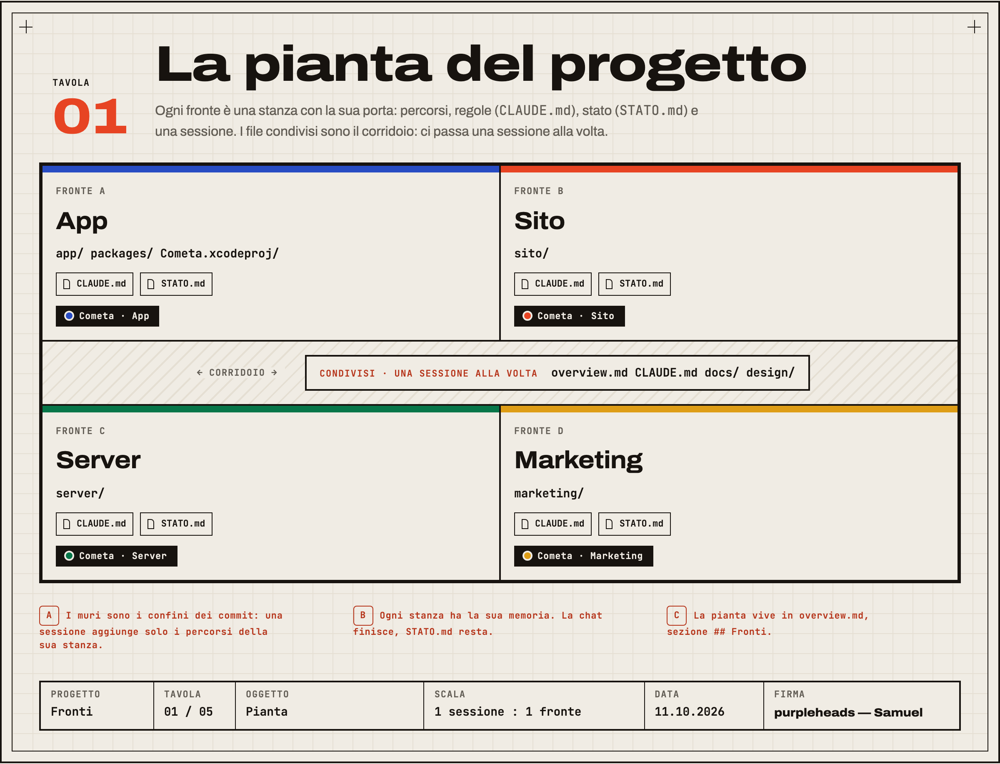
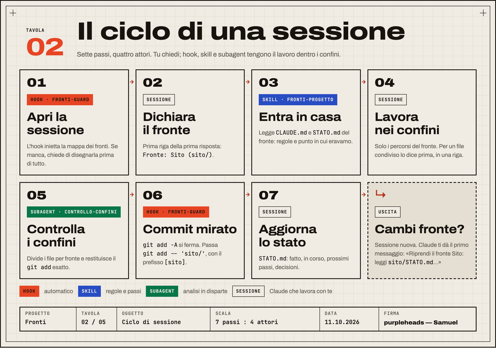
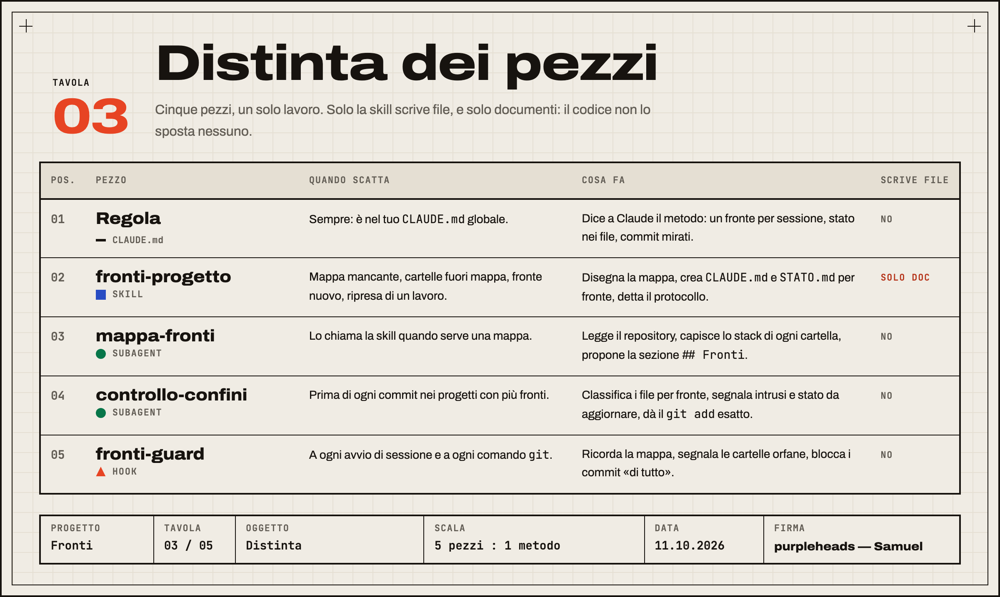
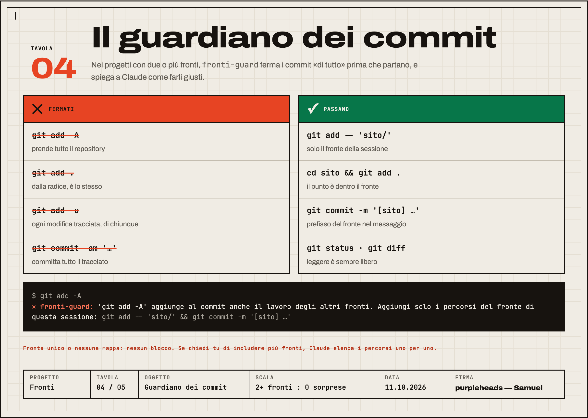
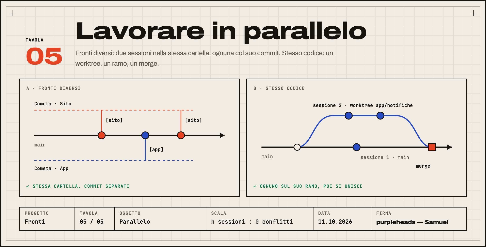

<p align="right"><b>Italiano</b> · <a href="README.en.md">English</a></p>

# Fronti

**Un progetto, più fronti, una sessione per fronte.** Plugin per [Claude Code](https://claude.com/claude-code) che divide ogni progetto in fronti di lavoro (app, sito, server, marketing, release…) e fa lavorare ogni sessione su un fronte solo: con le sue regole, il suo stato in un file e commit che non si portano via il lavoro degli altri.

[](https://github.com/purpleheads2026/claude-fronti/actions/workflows/test.yml)


**Guida illustrata:** [purpleheads2026.github.io/claude-fronti](https://purpleheads2026.github.io/claude-fronti/)



## Il problema

- **La sessione unica si riempie.** Prima l'app, poi il sito, poi i social: tutto nella stessa chat. Si riempie, viene riassunta e perde i dettagli.
- **Le sessioni parallele si pestano i piedi.** Due chat sullo stesso repository, e un `git add -A` si porta via il lavoro dell'altra.
- **Ogni volta si riparte da capo.** Se lo stato vive solo nella chat, muore con lei.

## Installazione

**Plugin (consigliato).** Nel prompt di Claude Code:

```
/plugin marketplace add purpleheads2026/claude-fronti
/plugin install fronti@claude-fronti
```

Skill, due subagent e hook insieme. L'hook parte da solo a ogni sessione: niente da configurare.

**Solo la skill**, per Claude Code, Codex, Cursor e gli altri agenti che leggono `SKILL.md` (senza hook):

```bash
npx skills add purpleheads2026/claude-fronti
```

**A mano.** Copia `skills/fronti-progetto/` in `~/.claude/skills/`, `agents/*.md` in `~/.claude/agents/`, `hooks/fronti-guard.py` in `~/.claude/hooks/`, poi aggiungi a `~/.claude/settings.json`:

```json
{
  "hooks": {
    "SessionStart": [
      { "hooks": [{ "type": "command", "command": "python3 ~/.claude/hooks/fronti-guard.py", "timeout": 10 }] }
    ],
    "PreToolUse": [
      { "matcher": "Bash", "hooks": [{ "type": "command", "command": "python3 ~/.claude/hooks/fronti-guard.py", "if": "Bash(git *)", "timeout": 10 }] }
    ]
  }
}
```

**La regola (consigliata in ogni caso).** Incolla [`regola/CLAUDE-snippet.md`](regola/CLAUDE-snippet.md) nel tuo `CLAUDE.md` globale: otto righe che Claude segue anche quando l'hook tace.

Serve Python 3 (già presente su macOS e Linux) e, per il guardiano dei commit, git.

## Come funziona



1. **Apri una sessione.** L'hook `fronti-guard` inietta la mappa dei fronti. Se il progetto non ce l'ha, chiede a Claude di disegnarla prima di tutto: la skill `fronti-progetto` lancia il subagent `mappa-fronti`, scrive la sezione `## Fronti` in `overview.md` e crea `CLAUDE.md` e `STATO.md` di ogni fronte. Nessun file di codice viene spostato.
2. **Claude dichiara il fronte** nella prima risposta, legge regole e stato del fronte e resta nei suoi percorsi.
3. **Prima del commit** il subagent `controllo-confini` divide i file per fronte e restituisce il `git add` esatto. L'hook blocca i commit «di tutto».
4. **A fine lavoro** Claude aggiorna `STATO.md`. La sessione dopo riparte da lì. Se cambi fronte, ti propone una sessione nuova con il primo messaggio pronto.







## Cosa chiedere

| Chiedi | Succede |
|---|---|
| «Mappa i fronti di questo progetto.» | Pianta in `overview.md`, `CLAUDE.md` e `STATO.md` per fronte. Nessun file spostato. La prima volta succede da solo. |
| «Lavoriamo sul fronte Sito: rifai la home.» | Dichiara il fronte, legge le sue regole, resta in `sito/`. |
| «Controlla i confini e fai il commit.» | `controllo-confini` separa i file e dà il `git add` giusto. |
| «Riprendi il fronte Marketing.» | Riparte da `marketing/STATO.md` e dagli ultimi commit del fronte. |
| «Apriamo il fronte Server.» | Cartella, riga nella mappa, regole, stato e il nome della sessione nuova. |
| «Fai il commit di tutto, anche dell'app.» | Si può: lo chiedi tu, e i percorsi vengono elencati uno per uno. |

## Il formato della mappa

```markdown
## Fronti

| Fronte    | Percorsi            | Casa         | Avvio | Sessione           |
|-----------|---------------------|--------------|-------|--------------------|
| App       | `app/`, `packages/` | `app/`       | —     | Cometa · App       |
| Sito      | `sito/`             | `sito/`      | —     | Cometa · Sito      |
| Marketing | `marketing/`        | `marketing/` | —     | Cometa · Marketing |

Condivisi (una sessione alla volta): `overview.md`, `CLAUDE.md`, `docs/`
```

- **Percorsi** tra backtick. Ogni cartella di primo livello sta in un fronte o tra i Condivisi, altrimenti l'hook la segnala.
- **Casa**: dove vivono `CLAUDE.md` e `STATO.md` del fronte.
- **Progetto semplice**: una riga sola con percorso `.`. Il guardiano dei commit resta spento.
- L'hook accetta anche `## Fronts` e `Shared:` per chi preferisce l'inglese.

## Domande

- **Sposta o rinomina i miei file?** No, mai. Se una cartella mescola due fronti te lo segnala e aspetta il tuo sì.
- **In che lingua parla?** Istruzioni in italiano, risposte nella tua lingua. I messaggi dell'hook sono in italiano o inglese: `FRONTI_LANG=it|en`, altrimenti segue `LANG`.
- **Funziona senza git?** La mappa, la skill e lo stato sì; il guardiano dei commit e il controllo delle cartelle fuori mappa hanno bisogno di git.
- **Come lo spengo?** `/plugin disable fronti@claude-fronti`. Installato a mano: togli le righe di `fronti-guard` dal `settings.json`.

## Sviluppo

```bash
python3 -m unittest discover -s tests -v      # test dell'hook
claude plugin validate .                      # manifest del plugin e del marketplace
cd tools && npm install && npm run tavole     # rigenera i PNG delle tavole da docs/index.html
```

Le tavole sono HTML e CSS veri dentro `docs/index.html`: i PNG di questo README sono fotografie della guida. I colori, la tipografia e gli spazi stanno in `design-tokens.json`.

## Licenza e firma

MIT © 2026 **purpleheads — Samuel**. Commit e tag firmati: su GitHub compaiono come *Verified*.
